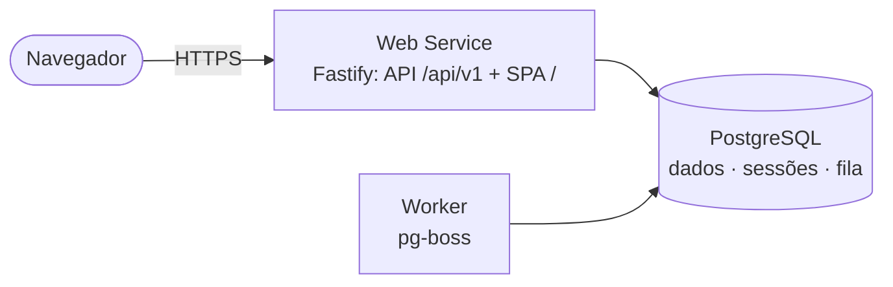

# Agenda Unimed

Aplicação web para cadastro, consulta, organização e importação em lote de contatos. Cada usuário autenticado tem sua própria agenda.

> **Destaques de engenharia**
>
> - Celular **único por usuário, inclusive entre inativos**, garantido por constraint do PostgreSQL. Provado por teste com 20 requisições simultâneas.
> - Importação CSV **assíncrona e idempotente**: registro, arquivo e job na mesma transação (pg-boss), checkpoint por lote, reprocessamento sem duplicados.
> - Sessão em cookie `HttpOnly`, CSP com Trusted Types, proteção contra CSRF e CSV injection.
> - Acessibilidade WCAG 2.2 AA verificada continuamente; adequação técnica à LGPD (anonimização, retenção, minimização).

## Stack

| Camada   | Tecnologias                                                                                               |
| -------- | --------------------------------------------------------------------------------------------------------- |
| Frontend | React 19.3 (React Compiler), Vite 8, TanStack Query · Router · Form · Table, Zod, shadcn/ui + Tailwind v4 |
| Backend  | Node.js 24 LTS, Fastify, Drizzle ORM, pg-boss, Zod, pino                                                  |
| Banco    | PostgreSQL (`citext`, `pg_trgm`, `unaccent`)                                                              |
| Testes   | Vitest, Testing Library, MSW, Testcontainers, Playwright, axe, k6                                         |
| Infra    | pnpm workspaces + Turborepo, Docker Compose, GitHub Actions, Render (Blueprint)                           |

## Como executar

**Pré-requisitos:** Docker e Docker Compose. Para desenvolvimento, Node.js 24 LTS (`.nvmrc`) e pnpm via Corepack (`corepack enable`).

```bash
# Ambiente completo, semelhante à produção
cp .env.example .env
docker compose up --build
docker compose exec api node dist/seed.js   # conta demo e dados de avaliação
# → http://localhost:3000   (usuário demo: demo@contatos.app / demo-contatos-2026)
```

```bash
# Desenvolvimento
pnpm install
pnpm db:up               # PostgreSQL via Compose
pnpm db:migrate          # migrations
pnpm db:seed             # conta demo e dados de avaliação
pnpm dev                 # API (watch) + Vite com proxy /api
pnpm --filter @contatos/api dev:worker   # worker (quando houver jobs)
pnpm test                # unitários (back + front)
pnpm test:integration    # integração com PostgreSQL real (requer Docker)
pnpm test:coverage       # backend: unitários + integração com metas de cobertura
pnpm test:e2e            # Playwright
```

> A conta demo é criada só pelo seed (`pnpm db:seed`, ou `node dist/seed.js` na imagem): cerca de 30 contatos (ativos, inativos e favoritos) e uma importação concluída com erros. Rodar de novo não duplica nada nem desfaz o que foi alterado na demo. Sem HTTPS, o cookie precisa de outro nome (`SESSION_COOKIE_NAME=sid`, já no `.env.example`): o navegador recusa cookies `__Host-` sem `Secure`.

## Deploy (Render)

O [`render.yaml`](render.yaml) declara a variante free: um Web Service Docker (API + SPA, migrations na inicialização) e um Postgres free. No dashboard do Render, use **New → Blueprint**, selecione o repositório e a branch `main` e aplique. O deploy automático só ocorre quando o CI da `main` passa.

> **O Postgres free expira 30 dias após a criação e os dados são apagados.** Para manter os dados, faça upgrade do plano antes do prazo (`plan: 0.1c-256mb` ou maior no `render.yaml`) ou exporte-os com `pg_dump "$EXTERNAL_DATABASE_URL" -Fc -f agenda.dump` (libere seu IP em `ipAllowList` para a conexão externa) e restaure num banco novo com `pg_restore`.

## Estado atual

Base de infraestrutura pronta; as funcionalidades abaixo são o escopo planejado.

- Monorepo com lint, formatação, typecheck, testes unitários (Vitest) e de integração (Testcontainers).
- API Fastify com `/api/health/live` e `/api/health/ready`, Problem Details e o SPA servido na mesma origem.
- Camada de dados: schema Drizzle, migration inicial (extensões, `f_unaccent`, constraints e índices) e migrations sob advisory lock.
- Imagem Docker única (API + SPA + worker + migrate), Docker Compose (`postgres`, `migrate`, `api`, `worker`), CI com smoke test da imagem e Blueprint do Render na variante free.
- O worker ainda não processa jobs: a fila (pg-boss) entra com a importação.

## Funcionalidades

- Criar conta, entrar e sair (inclusive de todas as sessões)
- Contatos: cadastrar, listar com paginação, buscar por nome/e-mail/celular (sem diferenciar acentos), filtrar por favoritos e status, editar com detecção de alteração concorrente, inativar/reativar, favoritar e eliminar dados (LGPD)
- Importação CSV: upload, acompanhamento em tempo real, relatório de erros por linha, download do CSV de erros e do CSV modelo, aviso de reenvio do mesmo arquivo

### Regra de unicidade para inativos (exigência do desafio)

O celular é único **na agenda de cada usuário, inclusive entre contatos inativos**. Cadastrar um número que pertence a um contato inativo retorna `409 MOBILE_BELONGS_TO_INACTIVE_CONTACT`, e a interface oferece reativar esse contato. O número só é liberado quando os dados do contato inativo são **eliminados** (anonimização). Justificativa completa em [ADR-001](docs/adr/ADR-001-unicidade-celular.md) e [ADR-009](docs/adr/ADR-009-lgpd-e-privacidade.md).

### Formato do CSV

```csv
nome;email;celular;telefone
Maria Silva;maria@empresa.com;(81) 99999-0000;(81) 3333-0000
```

Delimitador `,` ou `;`; UTF-8 ou Windows-1252; até 5 MB. Detalhes em [API › Formato do CSV](docs/05-api.md#formato-do-csv).

## Documentação

| Documento                                      | Conteúdo                                                                    |
| ---------------------------------------------- | --------------------------------------------------------------------------- |
| [01 · Requisitos](docs/01-requisitos.md)       | Escopo, requisitos funcionais, regras de negócio, requisitos não funcionais |
| [02 · Casos de uso](docs/02-casos-de-uso.md)   | Atores, diagrama UML, especificações                                        |
| [03 · Arquitetura](docs/03-arquitetura.md)     | C4 (contexto, containers, componentes), modelo de dados, implantação        |
| [04 · Fluxos](docs/04-fluxos.md)               | Sequências: auth, concorrência, importação, LGPD; ciclos de vida            |
| [05 · API](docs/05-api.md)                     | Contrato REST, erros, formato do CSV                                        |
| [06 · Frontend](docs/06-frontend.md)           | Rotas, componentes, estado, acessibilidade                                  |
| [07 · Estrutura](docs/07-estrutura.md)         | Monorepo, pastas, pipeline, scripts                                         |
| [08 · Qualidade](docs/08-qualidade.md)         | Análise ISO/IEC 25010, ameaças, rastreabilidade, limitações                 |
| [09 · Testes](docs/09-estrategia-de-testes.md) | Pirâmide, casos de teste, gates de CI                                       |
| [ADRs](docs/adr/README.md)                     | 11 registros de decisão de arquitetura                                      |

## Arquitetura em uma imagem



## Contribuição e segurança

Fluxo de trabalho, limite de arquivos por commit e gates locais no [CONTRIBUTING.md](CONTRIBUTING.md). Vulnerabilidades devem ser reportadas de forma privada, conforme o [SECURITY.md](SECURITY.md).

## Limitações conhecidas

Paginação por offset, upload limitado a 5 MB e ausência de recuperação de senha são escolhas conscientes para o escopo, com caminhos de evolução em [Qualidade › Limitações](docs/08-qualidade.md#84-limitações-conhecidas-e-evolução).
