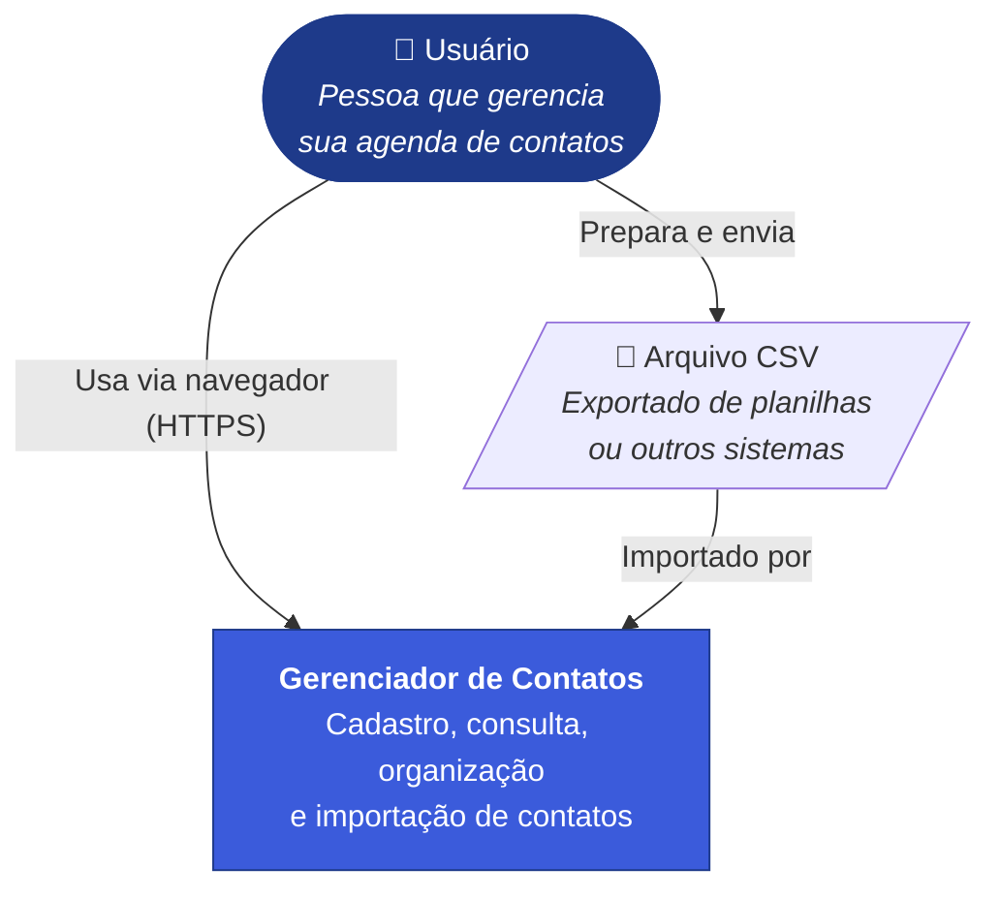
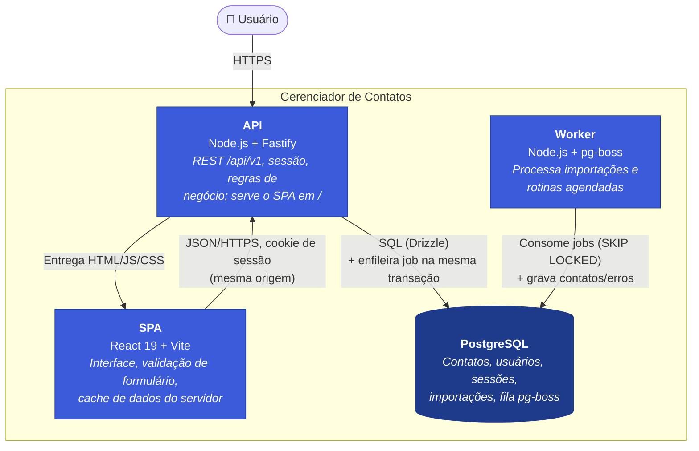
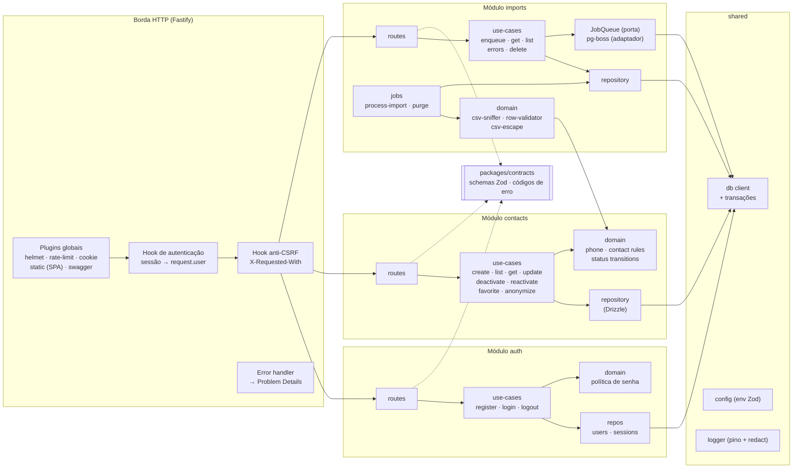
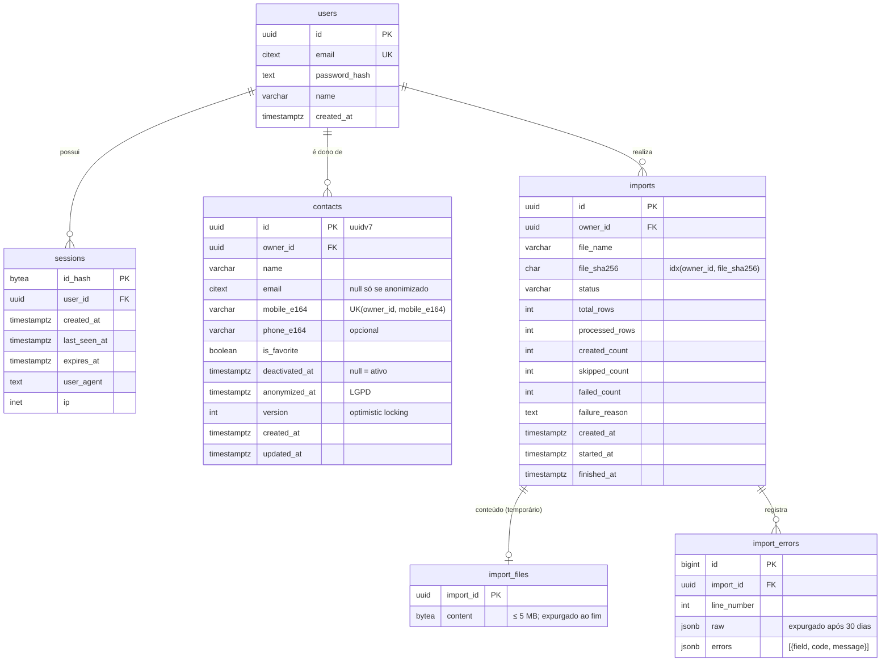
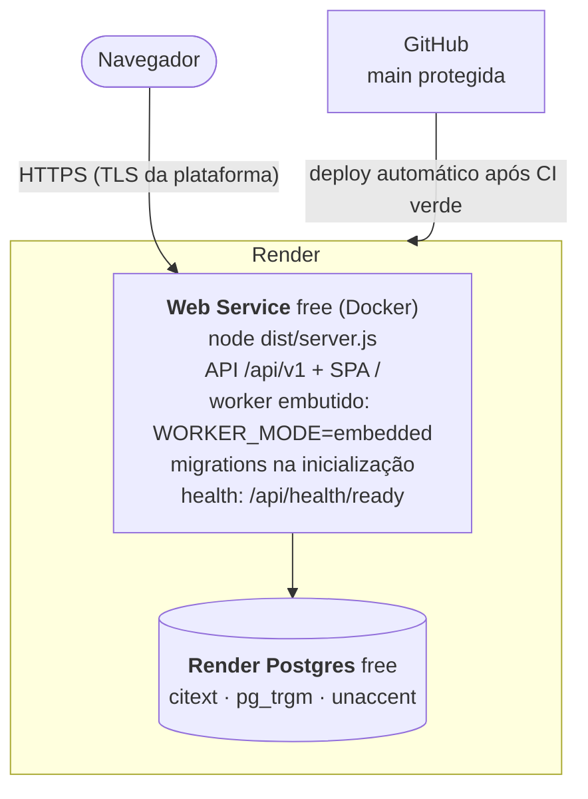

# 3. Arquitetura

Visão em camadas segundo o modelo **C4** (contexto → containers → componentes), complementada pelo modelo de dados e pela visão de implantação. As decisões que justificam cada elemento estão nos [ADRs](adr/README.md).

## 3.1 Princípios

1. **O banco garante invariantes; a aplicação as traduz.** Unicidade, idempotência e concorrência são resolvidas por constraints e transações do PostgreSQL (ADR-001/002/003).
2. **Uma única infraestrutura de estado.** Dados, fila, sessões e arquivos temporários ficam no PostgreSQL, evitando _dual write_ (ADR-003/006).
3. **Domínio puro, bordas finas.** Regras sem I/O e testáveis isoladamente; HTTP, banco e fila nas bordas (ADR-007).
4. **Contrato único.** Schemas Zod compartilhados entre API, OpenAPI e formulários (ADR-007/008).
5. **Privacidade por padrão.** Minimização, retenção e eliminação desde o desenho (ADR-009).

## 3.2 Nível 1 — Contexto

Não há integrações com sistemas externos no escopo. O sistema é autocontido.

## 3.3 Nível 2 — Containers

| Container  | Tecnologia                                                | Responsabilidades                                                               | Escala                                  |
| ---------- | --------------------------------------------------------- | ------------------------------------------------------------------------------- | --------------------------------------- |
| SPA        | React 19.3, Vite 8, TanStack Query/Router/Form, shadcn/ui | UI, navegação, validação de formulário, cache, acessibilidade                   | Estático, servido pela API              |
| API        | Node.js LTS, Fastify, Drizzle, Zod                        | Autenticação, autorização por dono, casos de uso, OpenAPI, headers de segurança | Horizontal (stateless; sessão no banco) |
| Worker     | Mesmo código da API, entrypoint `worker.ts`               | Importação de CSV, expurgo de dados, limpeza de sessões                         | Horizontal (`SKIP LOCKED`)              |
| PostgreSQL | PostgreSQL 16+ com `citext`, `pg_trgm`, `unaccent`        | Persistência, invariantes, fila                                                 | Vertical                                |

## 3.4 Nível 3 — Componentes da API

**Regras de dependência**
- `routes` conhecem `use-cases` e `contracts`; nunca acessam repositórios diretamente.
- `use-cases` orquestram transações e chamam `domain` e repositórios.
- `domain` não importa nada de I/O (verificado por regra de lint `no-restricted-imports`).
- O módulo `imports` reutiliza o domínio de `contacts` (validação e normalização), nunca o repositório de `contacts` por fora de um caso de uso.

## 3.5 Modelo de dados

**Constraints e índices relevantes**

| Objeto                                         | Definição                                                                              | Finalidade                                                 |
| ---------------------------------------------- | -------------------------------------------------------------------------------------- | ---------------------------------------------------------- |
| `contacts_owner_mobile_uq`                     | `UNIQUE (owner_id, mobile_e164)`                                                       | RN03; `NULL`s distintos liberam o número após anonimização |
| `contacts_pii_chk`                             | `CHECK (anonymized_at IS NOT NULL OR (email IS NOT NULL AND mobile_e164 IS NOT NULL))` | RN01 + RN09                                                |
| `contacts_list_idx`                            | `(owner_id, deactivated_at, is_favorite, name, id)`                                    | Listagem paginada e filtros                                |
| `contacts_name_trgm`                           | `GIN (f_unaccent(lower(name)) gin_trgm_ops)`                                           | Busca por nome (ADR-005)                                   |
| `contacts_email_trgm` / `contacts_mobile_trgm` | GIN trigram                                                                            | Busca por e-mail/celular                                   |
| `imports_owner_hash_idx`                       | `(owner_id, file_sha256)`                                                              | Detecção de reenvio (RN13)                                 |
| `import_errors_import_line_idx`                | `(import_id, line_number)`                                                             | Paginação dos erros                                        |

## 3.6 Implantação

### Produção — Render (Blueprint `render.yaml`)

Variante free: sem Background Worker nem pre-deploy, a API consome as filas e aplica as migrations na inicialização com `pg_advisory_lock`. Limitações: hibernação após 15 min sem tráfego, expurgo diário só com o serviço acordado e expiração do Postgres em 30 dias, sem backup.

| Variante                   | Diferença                                                                                                                                                                               |
| -------------------------- | --------------------------------------------------------------------------------------------------------------------------------------------------------------------------------------- |
| **Render pago**            | Background Worker (`WORKER_MODE=standalone`) e migrations no `preDeployCommand` (`node dist/migrate.js`, `MIGRATE_ON_BOOT=false`), em planos pagos. Topologia de referência do ADR-010. |
| **Local (Docker Compose)** | Serviços `postgres`, `migrate` (one-off), `api`, `worker`. Em desenvolvimento, o Vite roda com _proxy_ de `/api` para a API, mantendo a mesma origem.                                   |

### Configuração (variáveis de ambiente)

| Variável                                    | Exemplo                    | Uso                                                 |
| ------------------------------------------- | -------------------------- | --------------------------------------------------- |
| `DATABASE_URL`                              | `postgres://…`             | Conexão                                             |
| `NODE_ENV`                                  | `production`               | Comportamento                                       |
| `WORKER_MODE`                               | `standalone` \| `embedded` | Consumo da fila                                     |
| `MIGRATE_ON_BOOT`                           | `true` \| `false`          | Migrations na inicialização (Render free)           |
| `SESSION_COOKIE_NAME`                       | `__Host-sid`               | `sid` em dev sem HTTPS                              |
| `SESSION_IDLE_MINUTES` / `SESSION_MAX_DAYS` | `120` / `7`                | Expiração                                           |
| `IMPORT_MAX_BYTES`                          | `5242880`                  | Limite de upload                                    |
| `IMPORT_ERRORS_RETENTION_DAYS`              | `30`                       | Retenção (RN15)                                     |
| `LOG_LEVEL`                                 | `info`                     | Logs                                                |
| `WEB_DIST_DIR` (opcional)                   | `/app/apps/web/dist`       | Build do SPA servido em `/`; padrão `apps/web/dist` |

## 3.7 Preocupações transversais

| Tema           | Abordagem                                                                                                                                  |
| -------------- | ------------------------------------------------------------------------------------------------------------------------------------------ |
| Erros          | Problem Details (RFC 9457) com `code` estável; violação `23505` → `409`; erros inesperados → `500` sem detalhes internos, com `requestId`  |
| Logs           | `pino` JSON com `requestId`, `userId` (UUID) e duração; `redact` para corpo, cookies, `authorization` e `q`                                |
| Segurança HTTP | `@fastify/helmet`: CSP estrita com Trusted Types, HSTS, `frame-ancestors 'none'`, `Referrer-Policy: same-origin`, `X-Content-Type-Options` |
| Limites        | Corpo JSON ≤ 100 KB; upload ≤ 5 MB; `pageSize` ≤ 100; rate limit por IP e por conta nas rotas de auth                                      |
| Saúde          | `/api/health/live` (processo) e `/api/health/ready` (consulta `SELECT 1`)                                                                  |
| Encerramento   | `SIGTERM` → fecha o servidor HTTP e chama `boss.stop({ graceful: true })`                                                                  |
