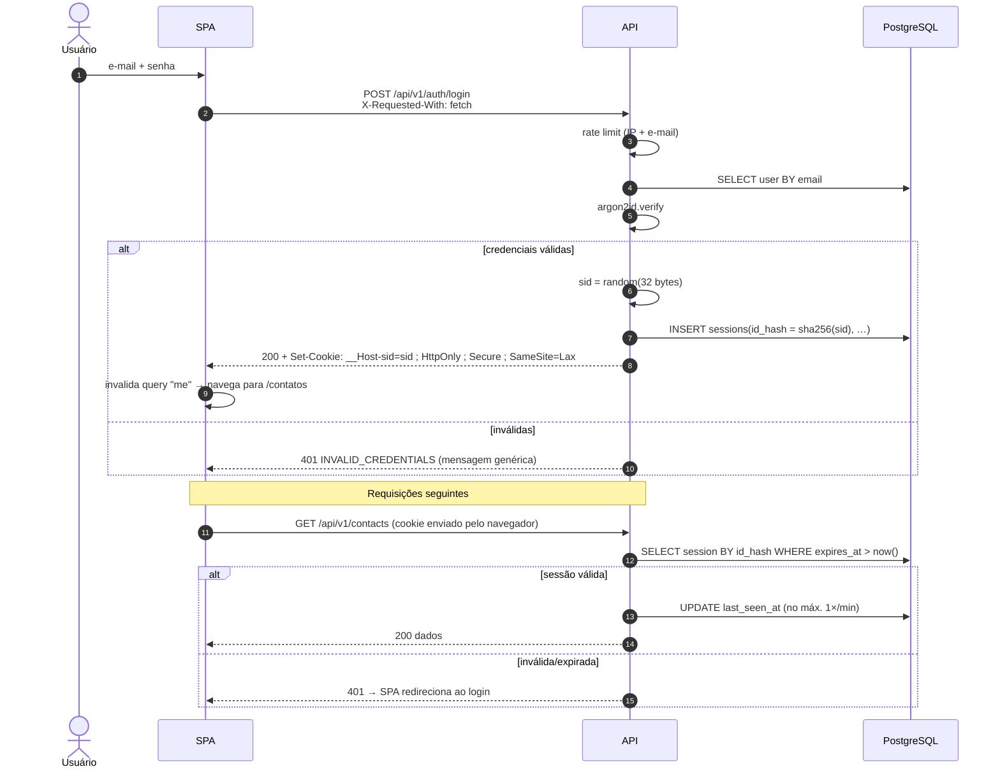
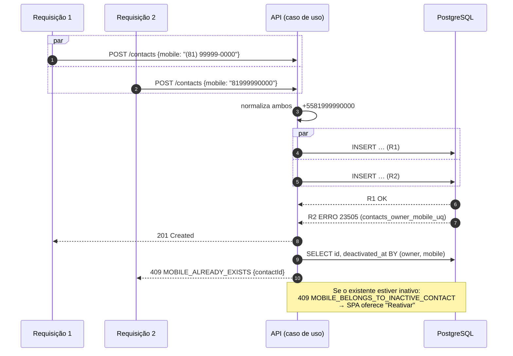
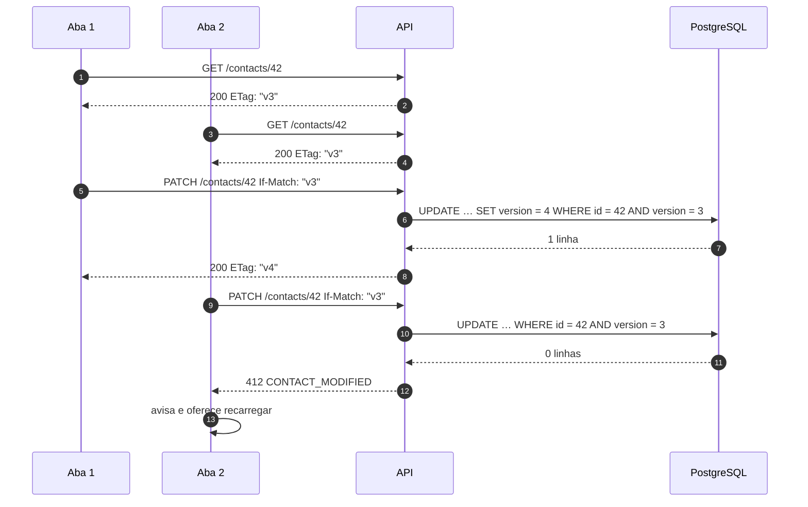
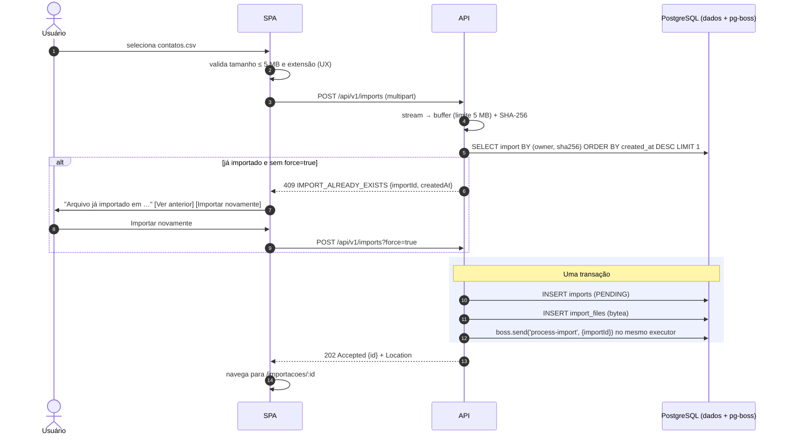
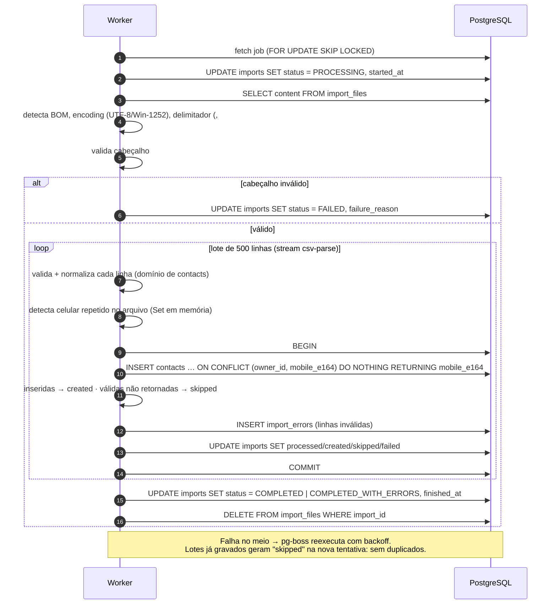
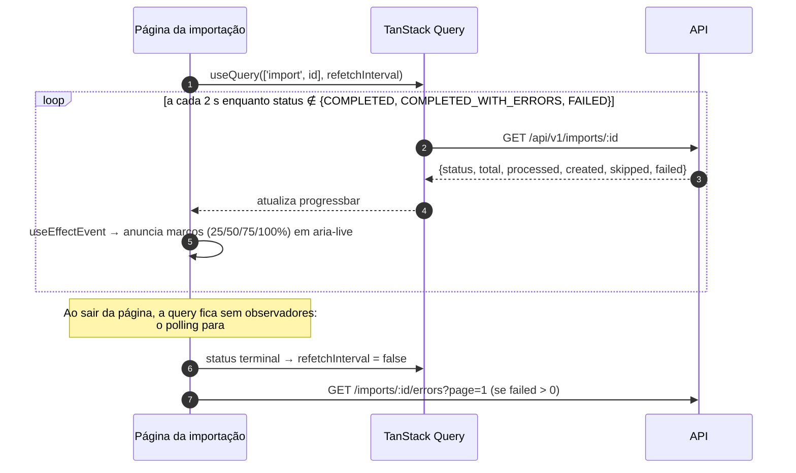
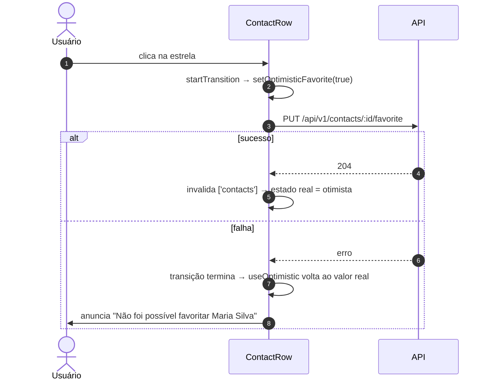
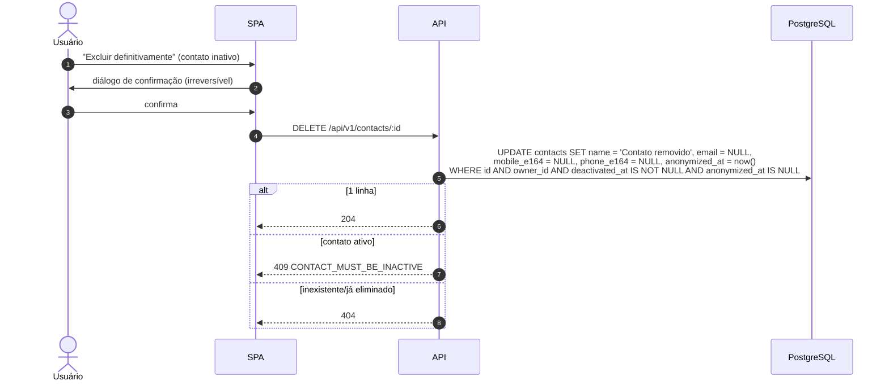
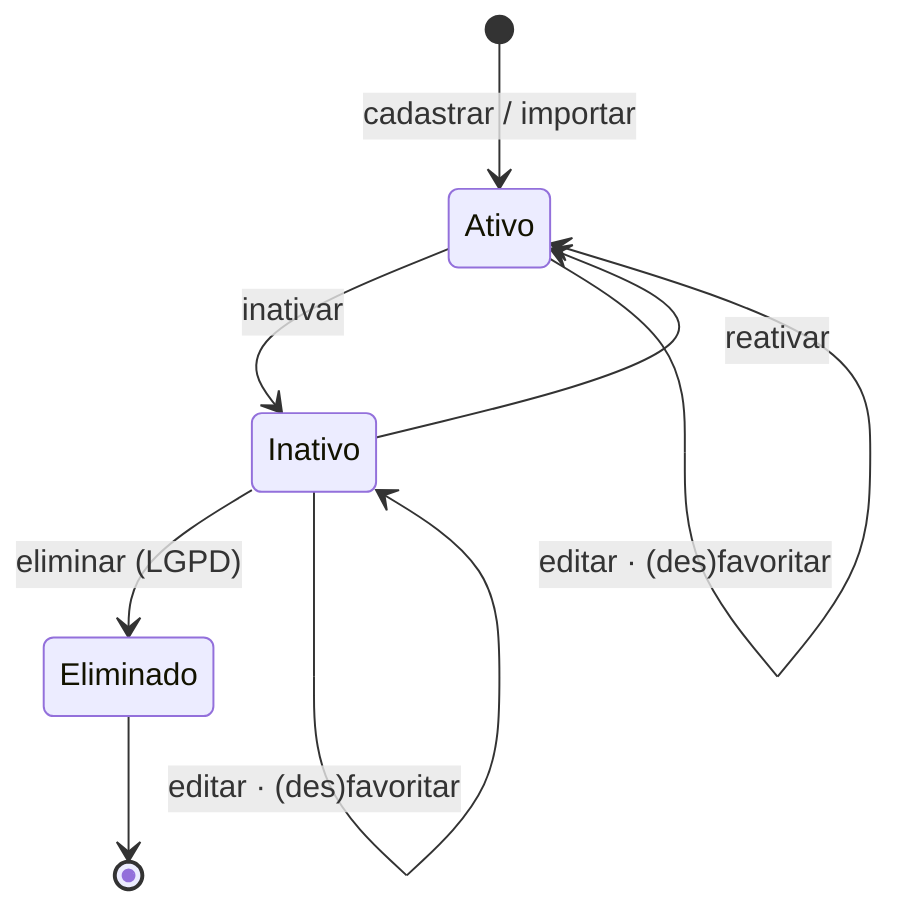
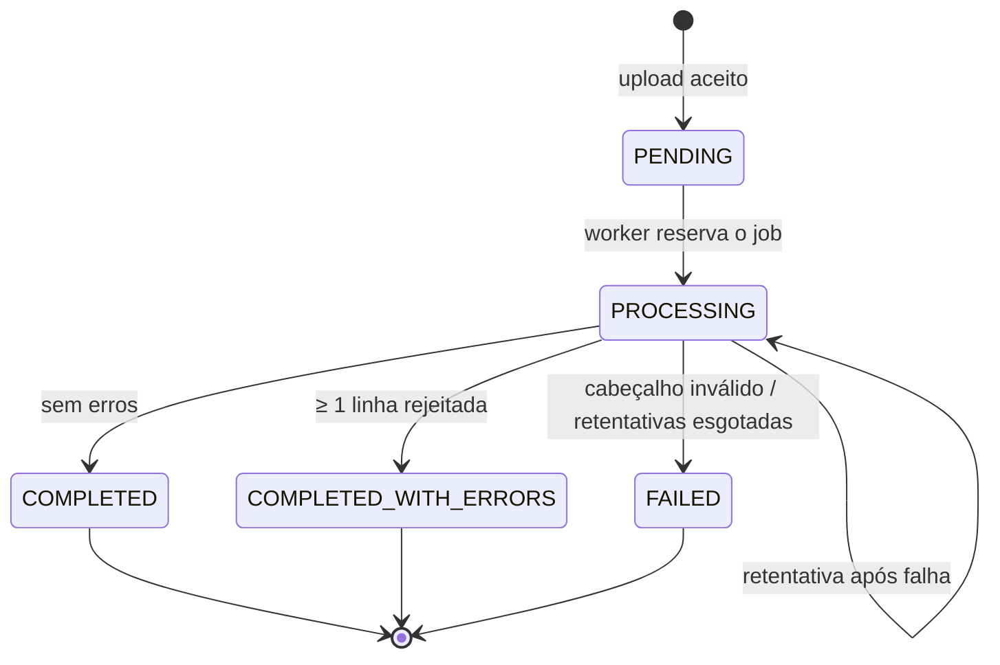

# 4. Fluxos

Diagramas de sequência dos fluxos com regras não triviais. Fluxos CRUD simples seguem o padrão `rota → caso de uso → repositório` e não são repetidos aqui.

## 4.1 Autenticação e requisição autenticada

## 4.2 Cadastro concorrente com o mesmo celular

Duas requisições simultâneas (duas abas, duplo clique ou API + worker) com o mesmo celular. A aplicação **não** consulta antes de inserir: a constraint é a única fonte da verdade.

## 4.3 Edição com controle de concorrência otimista

## 4.4 Importação: envio

## 4.5 Importação: processamento (worker)

> **Retomada após falha (checkpoint):** cada lote grava contatos, erros e contadores na **mesma transação**, então `processed_rows` é um checkpoint confiável. Numa retentativa, o worker relê o arquivo, reconstrói o conjunto de celulares já vistos (para manter a detecção de `DUPLICATE_IN_FILE`) e retoma a partir da linha `processed_rows + 1`. Se a falha ocorrer entre o `INSERT` e o `COMMIT`, o lote inteiro sofre rollback e é refeito. Os contadores ficam exatos e o `ON CONFLICT` continua como rede de segurança (caso T-INT12 da estratégia de testes).

## 4.6 Acompanhamento da importação (front)

## 4.7 Favoritar com atualização otimista

## 4.8 Eliminação de dados (LGPD)

## 4.9 Ciclos de vida

### Contato

### Importação

