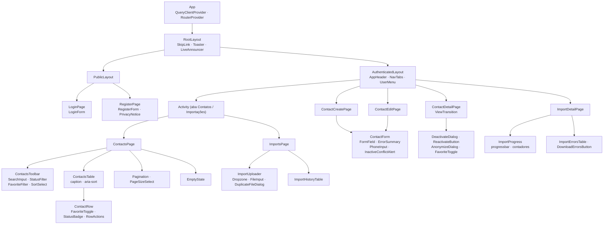
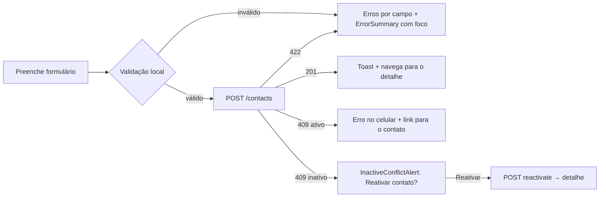
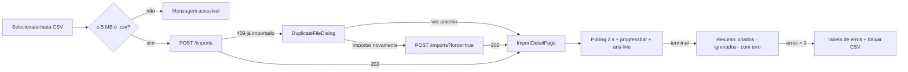

# 6. Frontend

SPA em React 19.3 + Vite 8, servida pela API na mesma origem. Decisões em [ADR-008](adr/ADR-008-frontend.md) e [ADR-009](adr/ADR-009-lgpd-e-privacidade.md).

## 6.1 Rotas (TanStack Router, _file-based_)

| Rota                   | Tela                                            | Acesso                              | Search params (validados com Zod)                                     |
| ---------------------- | ----------------------------------------------- | ----------------------------------- | --------------------------------------------------------------------- |
| `/entrar`              | Login (aviso de sessão expirada)                | Público (autenticado → `/contatos`) | `redirect?` (apenas caminhos internos), `motivo?` (`sessao-expirada`) |
| `/criar-conta`         | Cadastro + aviso de privacidade                 | Público                             | —                                                                     |
| `/privacidade`         | Aviso de privacidade completo (ADR-009 §6)      | Público                             | —                                                                     |
| `/contatos`            | Lista com busca, filtros e paginação            | Autenticado                         | `page`, `pageSize`, `status`, `favorite`, `sort` (**sem** `q`)        |
| `/contatos/novo`       | Formulário de cadastro                          | Autenticado                         | —                                                                     |
| `/contatos/$id`        | Detalhe (ações de status, favorito, eliminação) | Autenticado                         | —                                                                     |
| `/contatos/$id/editar` | Formulário de edição                            | Autenticado                         | —                                                                     |
| `/importacoes`         | Upload + histórico                              | Autenticado                         | `page`                                                                |
| `/importacoes/$id`     | Progresso, resumo e erros                       | Autenticado                         | `errorsPage`                                                          |
| `*`                    | Não encontrado                                  | —                                   | —                                                                     |
- O layout autenticado (`_auth`) usa `beforeLoad` com a query `me`: sem sessão → `/entrar?redirect=…`.
- O parâmetro `redirect` só aceita caminhos relativos iniciados por `/`, evitando _open redirect_.
- Um `401` em outra chamada (sessão expirada) leva a `/entrar?redirect=…&motivo=sessao-expirada`, que avisa a expiração.
- Cada rota é carregada sob demanda (code splitting) e define `<title>`.

## 6.2 Árvore de componentes

### Camadas do código

| Camada    | Pasta                                   | Conteúdo                                                                                       | Regra                                          |
| --------- | --------------------------------------- | ---------------------------------------------------------------------------------------------- | ---------------------------------------------- |
| Rotas     | `src/routes/`                           | Definição de rotas, loaders, search params                                                     | Sem lógica de UI complexa                      |
| Features  | `src/features/{auth,contacts,imports}/` | `components/`, `hooks/`, `api.ts` (query/mutation options)                                     | Feature não importa internals de outra feature |
| UI base   | `src/components/ui/`                    | Componentes shadcn/ui (Radix) adaptados                                                        | Sem conhecimento de domínio                    |
| Infra     | `src/lib/`                              | `http.ts` (fetch + CSRF + Problem Details), `query-client.ts`, `a11y/announce.ts`, `format.ts` | —                                              |
| Contratos | `@contatos/contracts`                   | Schemas Zod, tipos, códigos de erro                                                            | Fonte única com a API                          |

## 6.3 Estado

| Tipo de estado | Onde vive                               | Exemplos                                                                                                                   |
| -------------- | --------------------------------------- | -------------------------------------------------------------------------------------------------------------------------- |
| Servidor       | TanStack Query                          | `['me']`, `['contacts', filtros]`, `['contact', id]`, `['imports', page]`, `['import', id]`, `['import-errors', id, page]` |
| URL            | TanStack Router (search params tipados) | página, tamanho, status, favorito, ordenação                                                                               |
| Formulário     | TanStack Form                           | valores, erros por campo, `isSubmitting`                                                                                   |
| Efêmero de UI  | `useState` local                        | termo de busca, diálogos abertos                                                                                           |
| Otimista       | `useOptimistic`                         | favorito durante a requisição                                                                                              |

**Invalidações:** mutações de contato invalidam `['contacts']` e `['contact', id]`; uma importação concluída invalida `['contacts']`. **Logout** chama `queryClient.clear()`.

**Nada é persistido** em `localStorage`, `sessionStorage` ou IndexedDB (ADR-009).

## 6.4 Cliente HTTP (`lib/http.ts`)

- `credentials: 'same-origin'`, header `X-Requested-With: fetch` em mutações.
- Converte respostas `application/problem+json` em `ApiError { status, code, errors[], extras }`.
- `401` → invalida `me` e o router redireciona ao login.
- Funções tipadas por endpoint, com entrada e saída inferidas dos `contracts`.

## 6.5 Recursos do React aplicados

| Recurso                       | Componente                      | Benefício                                                    |
| ----------------------------- | ------------------------------- | ------------------------------------------------------------ |
| React Compiler 1.0            | Todo o app                      | Memoização automática; nenhum `useMemo`/`useCallback` manual |
| `useOptimistic`               | `FavoriteToggle`                | Resposta instantânea com rollback automático                 |
| `useDeferredValue` + debounce | `SearchInput` → `ContactsTable` | Digitação fluida e menos requisições                         |
| `<Activity>`                  | Abas Contatos/Importações       | Estado preservado; effects (polling) pausados quando oculta  |
| `useEffectEvent`              | `ImportProgress`                | Anúncios acessíveis sem reiniciar o intervalo                |
| `<ViewTransition>`            | Lista → detalhe                 | Continuidade visual; desligada com `prefers-reduced-motion`  |
| Fragment refs                 | `ContactForm`, diálogos         | Foco no primeiro campo inválido/primeiro elemento            |
| `<title>`                     | Rotas                           | Anúncio de navegação para leitores de tela                   |
| Suspense + `useSuspenseQuery` | Páginas                         | Estados de carregamento declarativos com skeletons           |
| `ref` como prop               | Componentes UI                  | Sem `forwardRef`                                             |

## 6.6 Fluxos de interface

### Cadastro com conflito de celular

### Importação

## 6.7 Acessibilidade (WCAG 2.2 AA)

| Área        | Implementação                                                                                                                                             |
| ----------- | --------------------------------------------------------------------------------------------------------------------------------------------------------- |
| Estrutura   | Landmarks (`header`, `nav`, `main`), um `h1` por página, skip link para `main`                                                                            |
| Formulários | `label` visível; `aria-invalid`; `aria-describedby` ligando dica e erro; `autocomplete` (`name`, `email`, `tel`); `ErrorSummary` com links para os campos |
| Tabela      | `<caption>`, `<th scope>`, `aria-sort` nas colunas ordenáveis; ações com nome contextual ("Editar Maria Silva")                                           |
| Estado      | Favorito como `button` + `aria-pressed`; status com texto e ícone, não só cor                                                                             |
| Diálogos    | Radix Dialog/AlertDialog: foco preso, `Esc`, retorno de foco ao gatilho                                                                                   |
| Dinâmico    | `LiveAnnouncer` (`aria-live="polite"`) para toasts, resultados de busca ("23 contatos encontrados") e marcos de importação                                |
| Upload      | Dropzone com `input type=file` acessível por teclado; instruções em texto                                                                                 |
| Movimento   | `prefers-reduced-motion` desliga transições                                                                                                               |
| Visual      | Contraste AA (tokens validados), foco visível (2.4.11/2.4.13), alvos ≥ 24 px (2.5.8), layout até 320 px e zoom de 200%                                    |

## 6.8 Segurança no cliente

- Sem tokens no JavaScript; cookie `HttpOnly`.
- CSP estrita com Trusted Types; nenhuma regra `dangerouslySetInnerHTML` permitida (lint).
- Saída sempre via JSX (escape automático); URLs externas inexistentes.
- `redirect` pós-login restrito a caminhos internos.
- `queryClient.clear()` no logout; nenhum dado pessoal em storage ou na URL.
