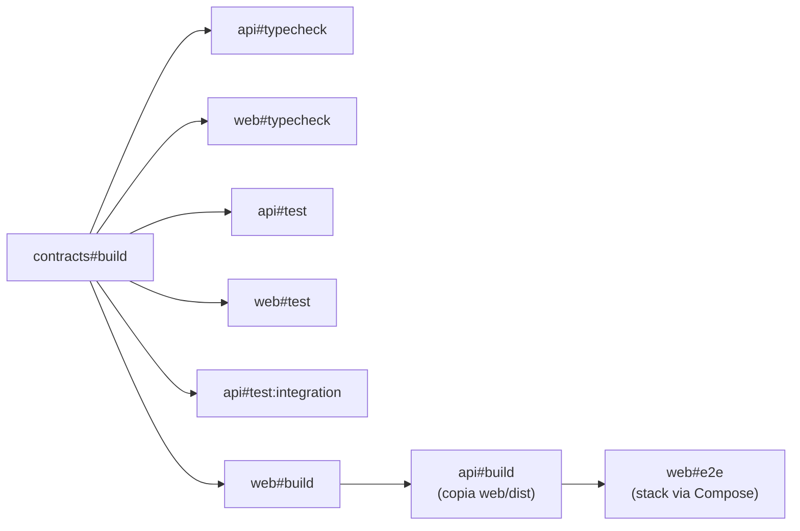

# 7. Estrutura do repositório

Monorepo **pnpm workspaces + Turborepo** (ADR-007, ADR-010).

```
.
├── apps/
│   ├── api/                         # Fastify: API + worker + serve o SPA
│   │   ├── src/
│   │   │   ├── modules/
│   │   │   │   ├── auth/
│   │   │   │   │   ├── domain/            # política de senha
│   │   │   │   │   ├── use-cases/         # register, login, logout, logout-all, me
│   │   │   │   │   ├── repositories/      # users, sessions
│   │   │   │   │   ├── hooks.ts           # autenticação, CSRF
│   │   │   │   │   └── routes.ts
│   │   │   │   ├── contacts/
│   │   │   │   │   ├── domain/            # phone.ts, contact.ts, status.ts, errors.ts
│   │   │   │   │   ├── use-cases/         # create, list, get, update, deactivate,
│   │   │   │   │   │                      # reactivate, set-favorite, anonymize
│   │   │   │   │   ├── repository.ts
│   │   │   │   │   └── routes.ts
│   │   │   │   └── imports/
│   │   │   │       ├── domain/            # csv-sniffer.ts, row-validator.ts,
│   │   │   │       │                      # csv-escape.ts, import-status.ts
│   │   │   │       ├── use-cases/         # enqueue, get, list, list-errors,
│   │   │   │       │                      # export-errors, delete
│   │   │   │       ├── jobs/              # process-import.ts, purge-retention.ts
│   │   │   │       ├── repository.ts
│   │   │   │       └── routes.ts
│   │   │   ├── shared/
│   │   │   │   ├── config/                # env.ts (Zod)
│   │   │   │   ├── db/                    # client, schema Drizzle, transações
│   │   │   │   ├── errors/                # AppError, Problem Details, mapa 23505
│   │   │   │   ├── http/                  # plugins: helmet, rate-limit, static, swagger
│   │   │   │   ├── queue/                 # JobQueue (porta) + pg-boss (adaptador)
│   │   │   │   └── logger.ts              # pino + redact
│   │   │   ├── app.ts                     # buildApp(): composição (testável)
│   │   │   ├── server.ts                  # entrypoint HTTP (+ embedded worker)
│   │   │   ├── worker.ts                  # entrypoint do worker
│   │   │   └── migrate.ts                 # migrations com advisory lock
│   │   ├── drizzle/                       # migrations SQL versionadas
│   │   ├── test/
│   │   │   ├── integration/               # Testcontainers + fastify.inject
│   │   │   ├── fixtures/                  # CSVs: utf8, win1252, ;, BOM, inválidos
│   │   │   └── helpers/                   # db container, factories, login helper
│   │   └── Dockerfile
│   └── web/                         # React + Vite
│       ├── src/
│       │   ├── routes/                    # TanStack Router (file-based)
│       │   ├── features/
│       │   │   ├── auth/       { components, hooks, api.ts }
│       │   │   ├── contacts/   { components, hooks, api.ts }
│       │   │   └── imports/    { components, hooks, api.ts }
│       │   ├── components/ui/             # shadcn/ui
│       │   ├── lib/                       # http, query-client, a11y, format
│       │   ├── test/                      # setup, MSW handlers, render helpers
│       │   └── main.tsx
│       ├── e2e/                           # Playwright
│       └── vite.config.ts
├── packages/
│   ├── contracts/                   # schemas Zod, DTOs, códigos de erro
│   ├── tsconfig/                    # bases TS (strict)
│   ├── eslint-config/               # flat config compartilhada (base, node, react)
│   └── vitest-config/               # presets do Vitest (node, react, integration)
├── docs/                            # esta documentação
├── .github/
│   ├── actions/setup/               # pnpm + Node + install + cache do Turbo
│   └── workflows/ci.yml
├── docker-compose.yml               # postgres, migrate, api, worker
├── render.yaml                      # Blueprint Render
├── turbo.json
├── pnpm-workspace.yaml
└── README.md
```

## 7.1 Responsabilidades por pacote

| Pacote                | Depende de                 | Publica                                                                                  |
| --------------------- | -------------------------- | ---------------------------------------------------------------------------------------- |
| `@contatos/contracts` | `zod`, `libphonenumber-js` | Schemas de entrada/saída, enums, códigos de erro, normalização de telefone compartilhada |
| `@contatos/api`       | `contracts`                | Imagem Docker (`server`, `worker`, `migrate`)                                            |
| `@contatos/web`       | `contracts`                | `dist/` estático, embutido na imagem da API                                              |

## 7.2 Pipeline do Turborepo



## 7.3 Scripts

| Comando                            | Efeito                                                              |
| ---------------------------------- | ------------------------------------------------------------------- |
| `pnpm dev`                         | Postgres via Compose + API (watch) + worker + Vite com proxy `/api` |
| `pnpm lint` / `pnpm typecheck`     | Em todos os pacotes (cache Turbo)                                   |
| `pnpm test`                        | Unitários (back e front)                                            |
| `pnpm test:integration`            | Integração com Testcontainers (requer Docker)                       |
| `pnpm test:e2e`                    | Playwright contra a stack completa                                  |
| `pnpm build`                       | Build de produção                                                   |
| `pnpm db:migrate` / `pnpm db:seed` | Migrations / usuário demo e contatos de exemplo                     |
| `docker compose up --build`        | Ambiente completo semelhante à produção                             |

## 7.4 Convenções

- **Commits:** Conventional Commits; PRs pequenos com ADR quando houver decisão.
- **Nomes:** arquivos em `kebab-case`; componentes em `PascalCase`; casos de uso como verbos (`create-contact.ts`).
- **Importações:** alias `@/` por app; proibido importar `modules/*/repository` fora do próprio módulo (lint).
- **Versões:** `version` de cada pacote segue SemVer a partir dos Conventional Commits da branch (`feat` → minor, `fix`/`perf`/`revert` → patch, `!`/`BREAKING CHANGE` → major), sempre um único bump sobre a versão da `main`. Os hooks `post-commit` e `post-rewrite` aplicam o bump (`scripts/bump-versions.js`); o CI verifica com `--check`.
- **Qualidade local:** `lint-staged` + Husky executam formatação, lint e typecheck dos arquivos alterados.
