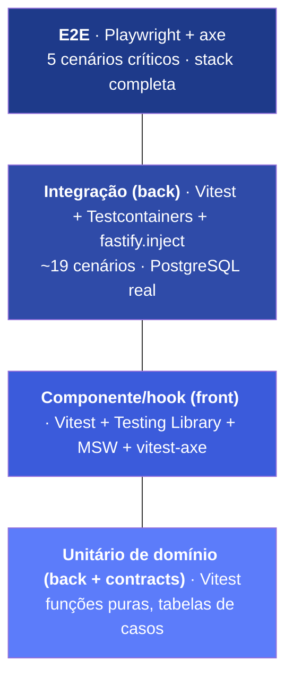
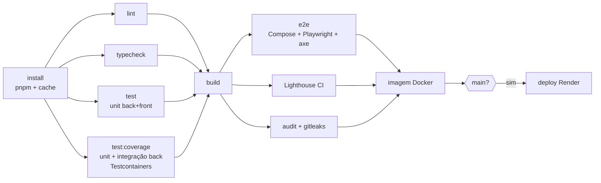

# 9. Estratégia de testes

## 9.1 Princípios

1. **Testar onde a regra mora.** Unicidade, idempotência e concorrência vivem no PostgreSQL. Por isso são testadas contra um PostgreSQL real (Testcontainers), nunca com mocks de repositório.
2. **Testar comportamento, não implementação.** No front, as asserções são feitas sobre o que o usuário percebe (texto, papel ARIA, foco), com a API simulada na camada de rede (MSW).
3. **Rápido na base, realista no topo.** Muitos testes unitários de domínio; integração nas fronteiras com o banco; poucos e2e nos fluxos críticos.
4. **Acessibilidade e segurança são testes, não revisões eventuais.** axe roda em testes de componente e e2e; CSRF, isolamento e CSV injection têm casos próprios.
5. **Determinismo.** Relógio injetável, IDs controlados nas factories, banco isolado por suíte, sem `sleep` em asserções (uso de `expect.poll`/`waitFor`).

## 9.2 Pirâmide

| Nível                     | Ferramentas                                                                              | Ambiente         | Quando roda                                            |
| ------------------------- | ---------------------------------------------------------------------------------------- | ---------------- | ------------------------------------------------------ |
| Unitário (back/contracts) | Vitest                                                                                   | Node, sem I/O    | Pre-commit (afetados) e todo PR                        |
| Componente (front)        | Vitest, Testing Library, `user-event`, MSW, `vitest-axe`                                 | jsdom            | Todo PR                                                |
| Integração (back)         | Vitest, Testcontainers (PostgreSQL 18), `fastify.inject`, pg-boss real                   | Docker           | Todo PR                                                |
| E2E                       | Playwright (Chromium, Firefox, WebKit; viewport desktop e móvel), `@axe-core/playwright` | Docker Compose   | Todo PR para `main`                                    |
| Não funcional             | k6, Lighthouse CI, `pnpm audit`, gitleaks                                                | CI / sob demanda | PR (Lighthouse, audit, gitleaks); k6 antes de releases |

## 9.3 Casos de teste

### Unitários — backend e contracts (T-UB)

| ID     | Alvo                       | Casos                                                                                                     | Req.       |
| ------ | -------------------------- | --------------------------------------------------------------------------------------------------------- | ---------- |
| T-UB01 | `normalizePhone`           | `(81) 99999-0000`, `81999990000`, `+55 81 9 9999-0000`, `081 99999 0000` → `+5581999990000`               | RN02       |
| T-UB02 | `assertMobile`             | Fixo (`(81) 3333-0000`) rejeitado com `NOT_A_MOBILE_NUMBER`; vazio e lixo → `INVALID_PHONE`               | RN02       |
| T-UB03 | `validateRow`              | Obrigatórios, limites de nome, e-mail inválido, telefone opcional, múltiplos erros na mesma linha         | RN01       |
| T-UB04 | `sniffCsv`                 | Delimitador `;` e `,`; BOM UTF-8; Windows-1252 com acentos; cabeçalho com variações (`E-mail`, `CELULAR`) | RN10       |
| T-UB05 | `escapeCsvCell`            | Células iniciadas por `=`, `+`, `-`, `@`, `\t`, `\r` recebem `'`; aspas e delimitadores escapados         | RNF03      |
| T-UB06 | Regras de status           | Eliminar só inativo; eliminado não reativa nem edita; inativar/reativar idempotentes                      | RN08, RN09 |
| T-UB07 | Tradução de erros          | `23505` em `contacts_owner_mobile_uq` → conflito correto; outras constraints → `500`                      | RN03       |
| T-UB08 | `parseSearchIntent`        | `"99999"` → celular; `"ana@"` → e-mail; `"joão"` → nome/e-mail; `"(81) 9"` → dígitos                      | RF07       |
| T-UB09 | Status final da importação | Sem erros → `COMPLETED`; com erros → `COMPLETED_WITH_ERRORS`; cabeçalho inválido → `FAILED`               | RN14       |
| T-UB10 | Schemas `contracts`        | Mesmas entradas válidas/inválidas usadas por API e front (_snapshot_ das mensagens)                       | RNF15      |

### Integração — backend (T-INT)

| ID          | Cenário                                                                                       | Resultado esperado                                                                                                         | Req.                   |
| ----------- | --------------------------------------------------------------------------------------------- | -------------------------------------------------------------------------------------------------------------------------- | ---------------------- |
| T-INT01     | Criar contato com celular mascarado                                                           | `201`; `mobile = +55…`; `version = 1`; `ETag`                                                                              | RF05, RN02             |
| T-INT02     | Criar com celular de contato ativo                                                            | `409 MOBILE_ALREADY_EXISTS` + `contactId`                                                                                  | RN03                   |
| T-INT03     | Criar com celular de contato inativo                                                          | `409 MOBILE_BELONGS_TO_INACTIVE_CONTACT` + `contactId`                                                                     | RN04                   |
| **T-INT04** | **20 `POST` simultâneos com o mesmo celular (variações de máscara)**                          | **Exatamente 1 × `201` e 19 × `409`; 1 linha no banco**                                                                    | **RN03, RNF06**        |
| T-INT05     | Usuário B acessa/edita/elimina contato e importação de A                                      | `404` em todas as rotas                                                                                                    | RN06, RNF04            |
| T-INT06     | Paginação com 45 contatos, nomes repetidos                                                    | Sem repetição/omissão entre páginas; `total`/`totalPages` corretos                                                         | RF06                   |
| T-INT07     | Busca: `joao` acha `João`; `9999` acha por celular; `@empresa` por e-mail                     | Resultados esperados; consulta usa índice GIN (`EXPLAIN`)                                                                  | RF07, RNF09            |
| T-INT08     | Filtros `status` × `favorite`                                                                 | Combinações corretas; eliminados nunca listados                                                                            | RF08                   |
| T-INT09     | `PATCH` sem `If-Match` / com versão antiga / correto                                          | `428` / `412` / `200` + versão incrementada                                                                                | RN07                   |
| T-INT10     | `PUT`/`DELETE` favorite e `deactivate`/`reactivate` repetidos                                 | Mesmo resultado em chamadas repetidas                                                                                      | RN08                   |
| T-INT11     | Importar fixture com válidas, inválidas, duplicata interna e celular já existente             | Contadores exatos; `DUPLICATE_IN_FILE` com `firstLine`; existente → `skipped`; contato existente inalterado                | RF16–RF18, RN11, RN12  |
| **T-INT12** | **(a) Processar o mesmo arquivo duas vezes; (b) falha simulada após o 2º lote e retentativa** | **(a) 2ª execução: `created = 0`, `skipped = N`; (b) contadores finais iguais a uma execução sem falha; nenhum duplicado** | **RN13, RNF07**        |
| T-INT13     | Upload com falha forçada ao enfileirar                                                        | Nenhuma linha em `imports`/`import_files` (rollback)                                                                       | ADR-003                |
| T-INT14     | Reenvio de arquivo idêntico sem e com `force=true`                                            | `409 IMPORT_ALREADY_EXISTS` → `202`                                                                                        | RF22                   |
| T-INT15     | Anonimizar ativo / inativo / repetido; recadastrar o celular liberado                         | `409` / `204` / `404`; novo cadastro `201`                                                                                 | RF14, RN09             |
| T-INT16     | Auth: login, `me`, logout invalida sessão; sessão expirada; mutação sem header; brute force   | `200`/`401` após logout/`401`/`403`/`429`                                                                                  | RF02–RF04, RNF01–RNF05 |
| T-INT17     | `errors.csv` com célula `=HYPERLINK("http://x")`                                              | Célula exportada como `'=HYPERLINK(…)`                                                                                     | RNF03                  |
| T-INT18     | Expurgo com relógio avançado em 31 dias                                                       | `raw = null`; contadores preservados (sessões expiradas não são expurgadas, ver 9.8)                                       | RN15                   |
| T-INT19     | Worker importa celular X enquanto a API cadastra X                                            | Um único contato; o outro lado recebe `409` ou `skipped`                                                                   | RNF06                  |

### Componente — frontend (T-UF)

| ID     | Alvo                        | Comportamento verificado                                                                          | Req.         |
| ------ | --------------------------- | ------------------------------------------------------------------------------------------------- | ------------ |
| T-UF01 | `ContactForm`               | Erros por campo com `aria-invalid`/`aria-describedby`; foco no `ErrorSummary`; sem violações axe  | RNF11, RNF12 |
| T-UF02 | `ContactForm` + 409 inativo | Exibe `InactiveConflictAlert`; "Reativar" chama a API e navega                                    | RN04         |
| T-UF03 | `ContactEditPage` + 412     | Aviso de alteração concorrente; recarregar mantém o texto local visível                           | RN07         |
| T-UF04 | `FavoriteToggle`            | `aria-pressed` muda na hora; falha → volta e anuncia erro                                         | RF13         |
| T-UF05 | `SearchInput`               | Uma requisição após 300 ms; `q` ausente da URL; anúncio da quantidade de resultados               | RF07, RN16   |
| T-UF06 | Filtros e paginação         | Search params refletem filtros; recarregar restaura o estado                                      | RF06, RF08   |
| T-UF07 | `ImportProgress`            | Polling cessa em status terminal; anúncios só nos marcos; `progressbar` com valores corretos      | RF17         |
| T-UF08 | `ImportUploader`            | Arquivo > 5 MB bloqueado; 409 abre `DuplicateFileDialog`; "Importar novamente" envia `force=true` | RF15, RF22   |
| T-UF09 | `lib/http`                  | Header CSRF em mutações; Problem Details → `ApiError`; `401` dispara redirecionamento             | RNF03        |
| T-UF10 | Logout                      | `queryClient` vazio após sair                                                                     | ADR-009      |
| T-UF11 | Páginas principais          | `vitest-axe` sem violações em estados vazio, carregado e com erro                                 | RNF11        |

### End-to-end (T-E2E)

| ID      | Cenário                                                                                                                      |
| ------- | ---------------------------------------------------------------------------------------------------------------------------- |
| T-E2E01 | Criar conta → sair → entrar → acessar rota protegida sem sessão redireciona                                                  |
| T-E2E02 | Cadastrar contato → inativar → cadastrar outro com o mesmo celular → reativar pela sugestão                                  |
| T-E2E03 | Importar CSV Windows-1252 com `;` e erros → acompanhar → ver erros → baixar CSV de erros → reimportar (aviso de duplicidade) |
| T-E2E04 | Fluxo T-E2E02 executado **apenas com teclado**, com axe em cada tela                                                         |
| T-E2E05 | Usuário B tenta abrir a URL de um contato de A → "Contato não encontrado"                                                    |

### Não funcionais (T-NF)

| ID     | Teste                                                                   | Critério                                                          |
| ------ | ----------------------------------------------------------------------- | ----------------------------------------------------------------- |
| T-NF01 | k6: listagem e busca com 10 mil contatos/usuário, 20 VUs                | p95 < 300 ms (RNF09)                                              |
| T-NF02 | k6: importação de 10 mil linhas com tráfego concorrente na API          | < 60 s; p95 da listagem < 500 ms durante a importação (RNF10)     |
| T-NF03 | Lighthouse CI em `/entrar`, `/contatos`, `/importacoes/:id`             | Acessibilidade ≥ 95; Performance ≥ 90; Boas práticas ≥ 95         |
| T-NF04 | `pnpm audit --prod`, gitleaks, verificação de headers (CSP/HSTS) em e2e | Sem vulnerabilidade alta/crítica; sem segredos; headers presentes |

## 9.4 Dados e ambiente de teste

- **Factories** (`test/helpers/factories.ts`) para usuários, contatos e importações, com sobrescrita parcial.
- **Fixtures CSV** versionadas em `apps/api/test/fixtures/`: `utf8-virgula.csv`, `utf8-bom-ponto-e-virgula.csv`, `win1252-ponto-e-virgula.csv`, `linhas-invalidas.csv` (inclui a célula `=HYPERLINK(...)` do T-INT17), `duplicados-no-arquivo.csv`, `cabecalho-invalido.csv` e `10k-linhas.csv` (gerado, não versionado).
- **Isolamento:** um container PostgreSQL por _worker_ do Vitest; cada teste roda em schema limpo (truncate entre testes) ou transação revertida, conforme o caso. Cenários com pg-boss usam truncate.
- **Relógio:** `Clock` injetável no domínio; `vi.useFakeTimers` no front.
- **MSW:** handlers tipados pelos `contracts`; cenários de erro por `server.use(...)` no próprio teste.

## 9.5 Cobertura e gates de qualidade

| Métrica                                          | Meta       | Ação se não atingir            |
| ------------------------------------------------ | ---------- | ------------------------------ |
| Cobertura de linhas — domínio (back + contracts) | ≥ 90%      | CI falha                       |
| Cobertura de linhas — global (back e front)      | ≥ 80%      | CI falha                       |
| Cobertura de branches — global                   | ≥ 70%      | Aviso no PR                    |
| Violações axe (_serious/critical_)               | 0          | CI falha                       |
| Erros de tipo / lint                             | 0          | CI falha                       |
| Testes instáveis (_flaky_)                       | 0 tolerado | Quarentena + issue obrigatória |

No backend, a cobertura **soma unitários e integração** numa mesma execução (`pnpm test:coverage`, projetos `unit` e `integration` do preset `@contatos/vitest-config/backend`): repositórios, migrations e rotas são medidos pelo que os testes contra o PostgreSQL real exercitam, sem exclusões artificiais. Só os entrypoints (`server`, `worker`, `migrate`) ficam fora. No frontend e em `contracts`, vale a cobertura dos unitários.

> Cobertura é um sinal, não um objetivo. Os testes-âncora (T-INT04 e T-INT12) valem mais que pontos percentuais.

## 9.6 Pipeline

## 9.7 Matriz requisito × teste (resumo)

| Requisito              | Testes                                                                |
| ---------------------- | --------------------------------------------------------------------- |
| RF02–RF04, RNF01–RNF05 | T-INT16, T-UF09, T-E2E01, T-NF04                                      |
| RF05, RN01–RN05        | T-UB01–03, T-UB07, T-INT01–04, T-UF01–02, T-E2E02                     |
| RF06–RF08, RN16        | T-UB08, T-INT06–08, T-UF05–06, T-NF01                                 |
| RF10, RN07             | T-INT09, T-UF03                                                       |
| RF11–RF13, RN08        | T-UB06, T-INT10, T-UF04                                               |
| RF14, RN09             | T-UB06, T-INT15                                                       |
| RF15–RF23, RN10–RN15   | T-UB04–05, T-UB09, T-INT11–14, T-INT17–19, T-UF07–08, T-E2E03, T-NF02 |
| RN06, RNF04            | T-INT05, T-E2E05                                                      |
| RNF06                  | **T-INT04**, T-INT19                                                  |
| RNF07                  | **T-INT12**, T-INT13                                                  |
| RNF11                  | T-UF01, T-UF11, T-E2E04, T-NF03                                       |

## 9.8 Resultados medidos

Execução de 27/10/2026, na versão da `main` com os testes E2E (#20). Medições locais num notebook com Intel Core i5-1235U (10 núcleos) e 16 GB de RAM; Docker Desktop com 12 CPUs e 8 GB; stack do `docker compose`.

### Testes e cobertura

| Suíte                                             | Testes                                 | Linhas | Branches | Funções |
| ------------------------------------------------- | -------------------------------------- | ------ | -------- | ------- |
| Backend: unitários + integração (`test:coverage`) | 509 em 43 arquivos                     | 100%   | 97,1%    | 100%    |
| `packages/contracts`                              | 133 em 7 arquivos                      | 100%   | 100%     | 100%    |
| Frontend (componentes e hooks)                    | 218 em 17 arquivos                     | 98,9%  | 95,7%    | 98,8%   |
| E2E (Playwright + axe)                            | 5 cenários × 4 projetos = 20 execuções | —      | —        | —       |
- As metas da seção 9.5 (domínio ≥ 90%, global ≥ 80% de linhas, branches ≥ 70%) são atendidas.
- **E2E:** 19 execuções verdes e 1 pulada (T-E2E04 no WebKit), sem violações axe _serious/critical_; a suíte completa leva de 1 min 40 s a 2 min.
- **T-E2E04 no WebKit:** pulado de propósito. Como no Safari padrão, o Tab do WebKit não foca links, e o Playwright não liga essa preferência.
- **Instabilidade observada:** rodando as suítes do backend e do front em sequência na mesma máquina, 4 testes do front estouraram o timeout de 5 s; isolados, passaram em duas execuções seguidas. Não reproduzido no CI.

### Casos não implementados como especificados

| Caso    | Situação                                                                                                                           |
| ------- | ---------------------------------------------------------------------------------------------------------------------------------- |
| T-INT18 | Cobre o expurgo de `raw` e a preservação dos contadores. Sessões expiradas **não** são removidas: a limpeza não foi implementada.  |
| T-INT19 | Sem teste da disputa API × worker. Há teste de duas execuções do worker no mesmo lote; a garantia é a mesma constraint do T-INT04. |

### k6 (T-NF01 e T-NF02)

Scripts em `perf/k6/`; massa de carga com `perf:seed` (10 mil contatos num usuário). k6 1.3.0 em container, contra `host.docker.internal:3000`.

**T-NF01:** 20 VUs por 60 s, sem pausa entre requisições.

| Endpoint                                     | Requisições | Média  | p90    | **p95**    | p99    | Máx.   | Erros |
| -------------------------------------------- | ----------- | ------ | ------ | ---------- | ------ | ------ | ----- |
| `GET /contacts` (página 1–400, 4 ordenações) | 4.396       | 152 ms | 202 ms | **220 ms** | 270 ms | 400 ms | 0%    |
| `GET /contacts?q=` (nome, e-mail e celular)  | 4.396       | 120 ms | 150 ms | **167 ms** | 211 ms | 321 ms | 0%    |

Vazão de 146 req/s. Meta p95 < 300 ms: **atingida**.

**T-NF02:** importação de 10 mil linhas (100 inválidas), com 20 VUs na listagem e na busca. Só entram na medição as requisições feitas enquanto a importação estava em andamento.

| Métrica                              | Resultado                                    | Meta     |
| ------------------------------------ | -------------------------------------------- | -------- |
| Envio → fim da importação            | **7,4 s** (6,2 s de processamento no worker) | < 60 s   |
| p95 da listagem durante a importação | **258 ms** (p99 285 ms; máx. 297 ms)         | < 500 ms |
| p95 da busca durante a importação    | **238 ms** (p99 297 ms; máx. 350 ms)         | < 500 ms |
| Erros                                | 0%                                           | —        |

Resultado: 9.900 contatos criados e 100 linhas com erro, como esperado. A amostra durante a importação é pequena (340 listagens e 340 buscas), porque ela termina rápido.

### Lighthouse CI (T-NF03)

Configuração em `lighthouserc.json`: mediana de 3 execuções; `/contatos` e `/importacoes/:id` auditadas com a conta do `perf:seed`. Execução local no Chromium do Playwright.

| Página             | Acessibilidade | Boas práticas | Performance |
| ------------------ | -------------- | ------------- | ----------- |
| `/entrar`          | 100            | 93            | 71          |
| `/contatos`        | 100            | 93            | 72          |
| `/importacoes/:id` | 100            | 93            | 81          |
| **Meta**           | ≥ 95           | ≥ 95          | ≥ 90        |
- **Acessibilidade: atingida.** É a única categoria que bloqueia o job no CI.
- **Boas práticas: não atingida.** As causas são erros no console: a cópia de CSS que o sonner injeta e a CSP bloqueia (ADR-008), o `401` esperado de `/auth/me` em `/entrar` e o `favicon.ico` ausente.
- **Performance: não atingida.** O peso principal é o tempo de bloqueio da thread principal (0,5 a 2,5 s com a CPU desacelerada que o Lighthouse simula). A variação entre execuções é grande (em `/entrar`: 48, 83 e 71).
- No CI, Boas práticas e Performance geram aviso, sem bloquear.
