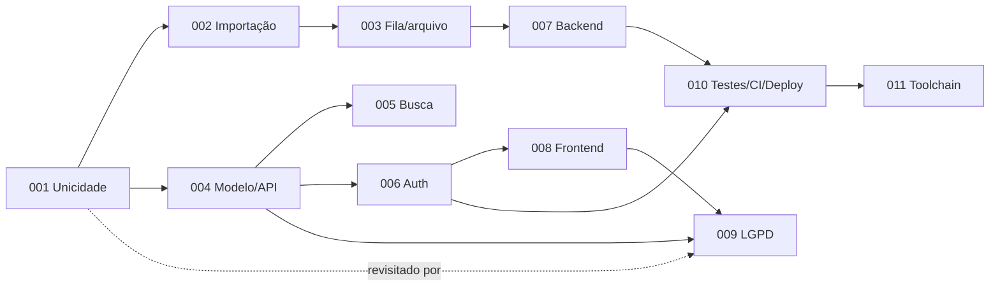

# Architecture Decision Records

Formato: contexto → decisão → alternativas → consequências. ADRs aceitos não são reescritos para mudar de ideia: uma decisão substituída recebe status **Substituído por ADR-XXX**. Os ajustes de alinhamento feitos durante a concepção estão refletidos no texto atual.

| ADR                                       | Título                                                | Status |
| ----------------------------------------- | ----------------------------------------------------- | ------ |
| [001](ADR-001-unicidade-celular.md)       | Unicidade do número de celular                        | Aceito |
| [002](ADR-002-importacao-idempotencia.md) | Importação CSV: idempotência e tratamento de linhas   | Aceito |
| [003](ADR-003-fila-e-armazenamento.md)    | Fila de processamento e armazenamento do arquivo      | Aceito |
| [004](ADR-004-modelo-de-dados-e-api.md)   | Modelo de dados e contrato da API REST                | Aceito |
| [005](ADR-005-busca.md)                   | Busca por nome, e-mail ou celular                     | Aceito |
| [006](ADR-006-autenticacao.md)            | Autenticação com sessão no servidor e cookie httpOnly | Aceito |
| [007](ADR-007-arquitetura-backend.md)     | Arquitetura do backend e organização do repositório   | Aceito |
| [008](ADR-008-frontend.md)                | Arquitetura do frontend                               | Aceito |
| [009](ADR-009-lgpd-e-privacidade.md)      | Privacidade e adequação à LGPD                        | Aceito |
| [010](ADR-010-testes-ci-e-deploy.md)      | Testes, integração contínua e deploy                  | Aceito |
| [011](ADR-011-toolchain-e-versoes.md)     | Toolchain e versões do repositório                    | Aceito |

## Mapa de dependências

